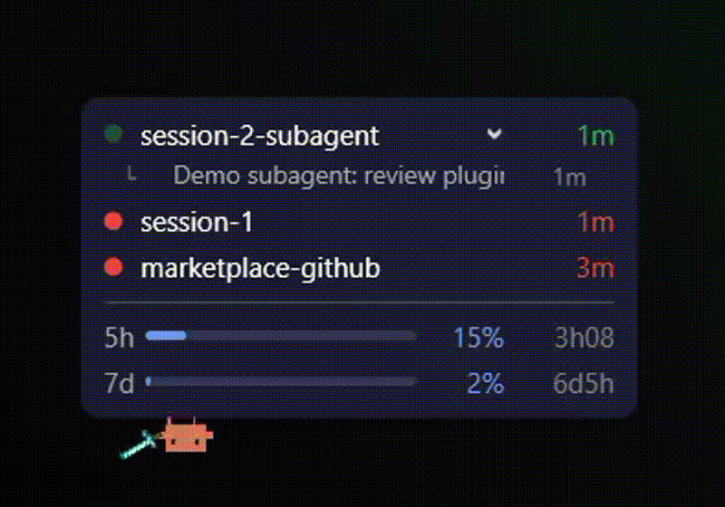

# claude-monitor-and-alerts



Keeps you in the loop while Claude Code works, so you can leave sessions running and switch to
other tasks:

- **Beeps** three times when Claude finishes a turn, asks you a question or needs permission.
- **Usage status line** with the 5-hour and weekly limits.
- **Monitor window** (optional): a small always-on-top window that lists every running session with
  its state and the same usage bars. Windows, WSL and macOS.

The monitor window is adapted from the open-source `ticlins-claude-monitor`
([LucasM-Maciel/ticlins-claude-monitor](https://github.com/LucasM-Maciel/ticlins-claude-monitor),
MIT). The original license and copyright notice are kept in
[`scripts/overlay/LICENSE-ticlins-claude-monitor.txt`](scripts/overlay/LICENSE-ticlins-claude-monitor.txt).

## What it does

The plugin ships no agents or skills. It registers hooks and one command:

| Hook event         | Matcher             | Script                | When it fires                                     |
| ------------------ | ------------------- | --------------------- | ------------------------------------------------- |
| `Stop`             | (all)               | `play_beep.sh`        | Claude finished its turn and is waiting for input |
| `PreToolUse`       | `AskUserQuestion`   | `play_beep.sh`        | Claude is about to ask you a question             |
| `PreToolUse`       | `AskUserQuestion`   | `hook.js question`    | The question box opened (blue in the window)      |
| `PostToolUse`      | (all)               | `hook.js resume`      | A tool ran: back to working after a permission or question |
| `PermissionRequest`| (all)               | `play_beep.sh`        | Claude or a subagent needs permission to run a tool |
| `PermissionRequest`| (all)               | `hook.js permission`  | Same, marks the session yellow in the window      |
| `SessionStart`     | (all)               | `setup_statusline.sh` | A session starts, resumes, or is cleared          |
| `UserPromptSubmit` | (all)               | `hook.js working`     | You sent a prompt                                 |
| `Stop`             | (all)               | `hook.js waiting`     | Claude finished its turn                          |
| `Notification`     | (all)               | `hook.js notification`| A question or permission request is pending       |
| `SessionEnd`       | (all)               | `hook.js end`         | The session ended                                 |
| `SubagentStart`    | (all)               | `hook.js subagent-start` | A subagent was launched                        |
| `SubagentStop`     | (all)               | `hook.js subagent-stop`  | A subagent finished                            |

| Command         | What it does                                  |
| --------------- | --------------------------------------------- |
| `/monitor-open` | Opens the monitor window (Windows, WSL, macOS) |

Hooks are informational: the scripts never block or alter Claude's behavior.

Subagent turns are ignored by the beep script: Claude Code fires the same hook events inside
subagents, so it exits early when the hook input carries an `agent_id`.

## Audible alerts

| Platform | Sound backend                                                |
| -------- | ------------------------------------------------------------ |
| WSL      | `powershell.exe` calling `[console]::beep`                   |
| macOS    | `afplay` with the system `Tink.aiff` sound                   |
| Linux    | `paplay` (PulseAudio/PipeWire) with a terminal bell fallback |

The terminal bell is written to `/dev/tty` because hook stdout is captured by Claude Code and never
reaches the terminal. In a headless session with no controlling terminal the bell fails silently.

## Usage status line

`scripts/statusline.sh` renders one bar per rate limit, with the time left until each resets:

```text
Session 5h ██░░░░░░░░  18% · resets in 3h 12m
Weekly     ████░░░░░░  41% · resets in 4d 7h
```

Claude Code plugins cannot set the `statusLine` setting themselves, so the `SessionStart` hook
configures it in your user settings under these rules:

- **Only when absent.** An existing `statusLine` key is never overwritten; the repair rule below
  is the only exception.
- **Once per machine.** The decision is recorded in a marker file, so removing the status line
  later does not bring it back.
- **Stable path.** The script is copied to the plugin data directory on every session start, and
  the setting points there instead of the versioned plugin install directory. Script updates
  therefore reach you without touching your settings again.
- **Self-repairing.** The plugin data directory is named after the plugin id, which includes the
  marketplace, and Claude Code deletes it on uninstall. When `statusLine` still points at this
  plugin's `statusline.sh` in a directory that no
  longer exists, the hook repoints the command to the current copy and leaves the other
  `statusLine` fields alone.
- **Visible.** The hook reports what it changed in a system message. Without `jq` installed it
  reports that instead and writes nothing.

The write is atomic: the new settings file is built next to the old one and renamed over it,
keeping the original permissions. A symlinked `settings.json` is followed, so dotfiles setups keep
their link. If Claude Code rewrites the file during setup, the hook leaves it alone and retries on
the next session start.

To change or remove the status line, run `/statusline` or delete the `statusLine` key from
`~/.claude/settings.json`. To make the hook evaluate your settings again, delete
`statusline-setup-done` from the plugin data directory, which is the directory of the
`statusLine.command` path in your settings.

Each time the status line renders, it also saves the rate limits to `~/.claude-monitor/usage.json`
(mode 0600; on WSL, to the Windows profile's `.claude-monitor` once the window folder exists). That
file is how the monitor window shows the usage bars: **the window never reads your Claude login and
never calls any API.** If you use your own status line, the bars stay empty.

## Monitor window

| Dot            | Meaning                    |
| -------------- | -------------------------- |
| green, pulsing | working                    |
| red            | finished (waiting for you) |
| blue           | asked you a question       |
| yellow         | waiting for a permission   |

The number next to a session is how long it has been in that state.

Run `/monitor-open` to open it (Node.js is required for the session tracking). It copies the window
files to `~/.claude-monitor` and starts the window: PowerShell/WPF on Windows (also from WSL), and
Swift on macOS, compiled the first time (needs the Xcode command line tools).

The window can be opened at any time, but a session only shows up in it if the plugin's hooks were
loaded when that session started. Sessions that were already open when you installed the plugin
appear after you run `/reload-plugins` in them, or after you reopen them; new sessions appear on
their own.

While a session has subagents running, the window shows one indented child row per subagent under
it (`└ Review the auth module  1m`), with what the subagent is doing (the description given when it
was launched, or its type when none is available yet) and how long it has been running. A
description wider than the row scrolls sideways. The rows disappear when the
subagent finishes. A subagent stopped before finishing (with `TaskStop` or from the UI) fires no
stop event: its row goes away on the session's next event, and any other missed one after 2 hours. A
subagent finishing does not mark its parent session as finished.
If the main agent finishes its turn while subagents are still running (for example in the
background), the session keeps showing as **working** (green) and only turns to finished when the
last subagent ends.

A session that has subagents shows a **`>` pointing down** at the right of its name. Click it to
collapse that session's subagent rows (it turns into `> 3`, the number of subagents); click again
to expand. Clicking anywhere else on the session row still opens the session. The collapsed state
lasts while the window is open.

To take a session off the list (for example one that already finished, or a ghost that is still
listed), **right-click its row > Remove session from the monitor**. This deletes the session's state
file in `~/.claude-monitor/sessions/`; a session that is still running comes back by itself the next
time it does something.

Right-click the window for:

- **Show mascot** (the Claude Code mascot, Clawd).
- Opacity and volume.
- **Show usage** (on by default), **Show subagents** (on by default; hides every subagent row)
  and **Window sound** (off by default, because the beeps already alert you).

### Custom window sounds

With **Window sound** on, the window uses the system sounds. To use your own, put files with these
fixed names in `~/.claude-monitor/sounds/` (on WSL, the Windows profile's `.claude-monitor\sounds`).
`.wav` and `.mp3` are accepted; a missing file keeps the default:

| File       | Plays when                                              |
| ---------- | ------------------------------------------------------- |
| `finished` | a session finished                                      |
| `all-done` | the last running session finished (nothing left to do)  |
| `question` | a session asked a question or is waiting for permission |

The files are read when the window starts: close it (right-click > Close) and run `/monitor-open`
again after adding them.

### WSL

`/monitor-open` works from a WSL session: it copies the window files to the Windows profile's
`.claude-monitor` and starts the window on Windows (profile names with spaces or non-ASCII
characters are rejected). Sessions started inside WSL are written to that same folder, without a
pid, so the window keeps them for up to 6 hours unless `SessionEnd` removes them first.
Transcript-based details (renamed titles, a reply that ends in a question) are not available for
them; the question box still turns the dot blue, because the hook marks it.

## Requirements

- `jq` for the status line. The beeps work without it.
- Bash 4 or newer (macOS ships Bash 3 as `/bin/bash`; the scripts run through the `bash` on your
  `PATH`).
- Node.js for the monitor window's session tracking. Without it, those hooks do nothing and the
  beeps and status line keep working.
- Do not install the original VS Code extension of ticlins-claude-monitor at the same time.

## Installation

```text
/plugin marketplace add https://github.com/anascunha/claude-monitor-and-alerts
/plugin install claude-monitor-and-alerts@claude-monitor-and-alerts
```

The beep hooks are active as soon as the plugin is installed. The status line setup runs on the
next session start, so run `/clear` or restart Claude Code after installing to trigger it; the
status line then appears on the following session start. Run `/monitor-open` to open the window.

### Claude desktop app (Code tab, experimental)

The monitor tracks **Claude Code sessions**. In the Claude desktop app that means the **Code** tab;
ordinary Chat conversations are not Claude Code sessions and are not tracked.

Adding this repository does not install the plugin anywhere: each person adds the
marketplace and enables the plugin. The desktop **Customize > Plugins** screen is a separate list
(it syncs with your claude.ai account) and does not show plugins installed with `/plugin`. To try the
plugin in the Code tab, enable it in your user settings instead:

1. Open `~/.claude/settings.json` (Windows: `C:\Users\<you>\.claude\settings.json`) and add:

   ```json
   {
     "extraKnownMarketplaces": {
       "claude-monitor-and-alerts": {
         "source": {
           "source": "git",
           "url": "https://github.com/anascunha/claude-monitor-and-alerts"
         }
       }
     },
     "enabledPlugins": { "claude-monitor-and-alerts@claude-monitor-and-alerts": true }
   }
   ```

   Keep any keys that are already in the file. To try a local checkout instead, use
   `"source": "directory"` with a `"path"`.
2. Restart the desktop app, open a **Code** session and send a prompt.
3. Check that a file appeared in `~/.claude-monitor/sessions/` (Windows:
   `C:\Users\<you>\.claude-monitor\sessions\`). Open the window with
   `/claude-monitor-and-alerts:monitor-open` in the same session, or from a terminal with
   `node <plugin folder>/scripts/open-overlay.js`.

Requirements on that machine: Node.js, access to this repository, and, on Windows, a
shell that understands the hook commands (they use `command -v`, a bash construct).

> **Status:**
> - **Confirmed:** a **Code** session of the desktop app on a project inside WSL ran the plugin's
>   hooks: it wrote a state file (`entrypoint` `claude-desktop`) and showed up in the window.
> - **Not confirmed yet:** projects in a native Windows folder (where the Windows `settings.json`
>   and the hook shell matter, since the hooks use `command -v`, a bash construct) and the Mac app.
>   The Claude documentation is not consistent about these cases. If no file appears in step 3, use
>   the plugin from a terminal or the VS Code extension.
>
> An organization owner can also enable it for everyone through *Organization settings > Claude Code >
> Managed settings* (same two keys), but that installs it for all members and they cannot turn it off.

## Security notes

- The window never updates or relaunches itself, never contacts GitHub, and does not read the
  Claude Code login token or call `api.anthropic.com`.
- It only reads transcript files that are regular files under `~/.claude/projects`.
- Session files are written with mode 0600 in a 0700 folder; session ids are validated.
- `monitor.log` records only short fixed messages and exception type names.
- Windows starts the window with a process-scoped `-ExecutionPolicy Bypass` on the copied file.
- The sound/texture downloader and the bundled audio decoder of the original project (which fetched
  Minecraft assets from Mojang's servers) are not part of this plugin: the window only uses system
  sounds, your own files in `~/.claude-monitor/sounds/`, and the drawings made in its own script.

## Testing

Run the scripts directly to confirm your machine can play the sound and render the bars:

```bash
bash scripts/play_beep.sh
echo '{"rate_limits":{"five_hour":{"used_percentage":18,"resets_at":1757400000},"seven_day":{"used_percentage":41,"resets_at":1757450000}}}' \
  | bash scripts/statusline.sh
```

To confirm the hooks are registered inside a session, run `/hooks` or start Claude Code with
`claude --debug` and watch the log when a turn ends. For the window: open two sessions, send a
prompt in each, and check that a file per session appears in `~/.claude-monitor/sessions/` and that
the dots change as described above.

## Open items

- **macOS is untested.** `overlay.swift` was edited without a Mac and has never been compiled or
  run. Run `swiftc -swift-version 5 -parse scripts/overlay/overlay.swift` on a Mac before merging.
- **Design.** The pickaxe, sword, diamond and stone drawn during the mascot's idle scenes are
  Minecraft-style drawings made in the script (no Mojang assets); decide whether to keep them.
- The Clawd mascot is the Claude Code mascot (an Anthropic character); check that using it in your
  context is fine.
- **Session links** use the `vscode://local.claude-monitor` scheme of the original extension, which
  is not part of this plugin, so clicking a session only brings the editor to the front.
- Native Linux has no monitor window.
- **Subagent rows and removing a session on macOS:** the Swift parts (child rows, collapse chevron,
  scrolling description, Show subagents, Remove session) were written without a Mac and have not been
  compiled.
- **Claude desktop app:** works for Code sessions on WSL projects; native Windows folders and the
  Mac app are not confirmed (and the hook shell on Windows is undocumented); see [Claude desktop app](#claude-desktop-app-code-tab-experimental).
